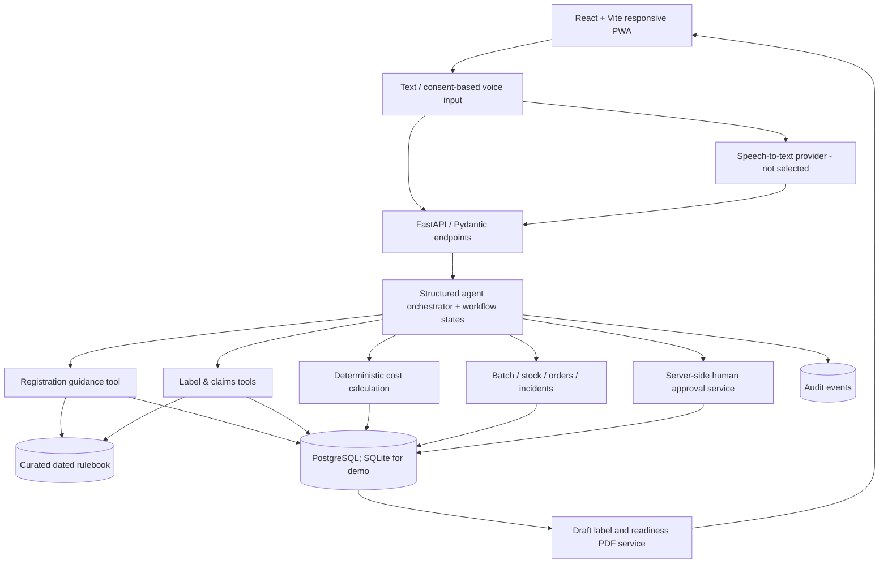
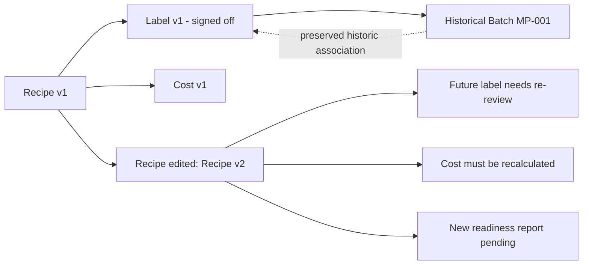

# Proposed System Architecture

> **Design proposal only.** No environment, integration, database or application has been deployed.

## Layered design

## Candidate technologies (not selected as contracts)

| Layer | Proposed choice | Decision status |
|---|---|---|
| Frontend | React + Vite PWA | Candidate architecture |
| Backend | Python FastAPI, Pydantic | Candidate architecture |
| Database | PostgreSQL; local SQLite for initial demo | Candidate architecture |
| Agent orchestration | Explicit state machine and typed tool calls; evaluate LangGraph / PydanticAI only if needed | Not finalized |
| LLM | Hosted structured-output/tool-calling model | Vendor not selected |
| Speech recognition | Sarvam Saaras v4/v3, Google Chirp 3 Kannada **Preview**, possibly BHASHINI if access verified | **Benchmark pending** |
| Regulatory knowledge | Human-reviewed official sources, dated and scoped SQL/JSON rules | Validation pending |
| Calculations | Deterministic Python logic and explicit formulas | Not implemented |
| Outputs | HTML/CSS-to-PDF drafts | Not implemented |
| Storage | Private document bucket, restricted access | Not implemented |

## Rule metadata contract

A proposed rule record should track:

`rule_id`, `authority`, `source_url`, `publication_date`, `effective_from`, `effective_to`, `legal_status`, `product_scope`, `packaging_scope`, `channel_scope`, `exemptions`, `logic_version`, `evidence_basis`, `reviewer`, `last_reviewed`.

Only rules that **apply** to the current product and pack, and are **in force** for the relevant date, may trigger definitive legal checks. Scheduled, superseded or in-abeyance rules must not be applied as currently binding by default.

## Proposed entities

- `Producer`, `Business`, `Product`, `RecipeVersion`, `IngredientLine`
- `Document`, `Evidence`, `RuleVersion`, `RuleEvaluation`
- `LabelVersion`, `Approval`, `CostScenario`
- `Batch`, `StockMovement`, `Order`, `Complaint`, `Incident`
- `ReadinessReport`, `ReadinessItem`, `AgentAction`, `AuditEvent`

## Change propagation example

**Invariant:** Recipe version 2 does not rewrite label version 1 or batch MP-001 history. Any new label or report dependent on the altered recipe needs review.

## Threat model at a glance

- Recipe data, supplier details and business documents are commercially sensitive.
- Speech, LLM calls and document uploads need clear consent, privacy controls and retention rules.
- All external actions are authorized server-side, not only hidden behind a button.
- Audit records need event provenance and an identifiable human reviewer.
- Supplier/model responses cannot override trusted program policy or legal-rule status.
