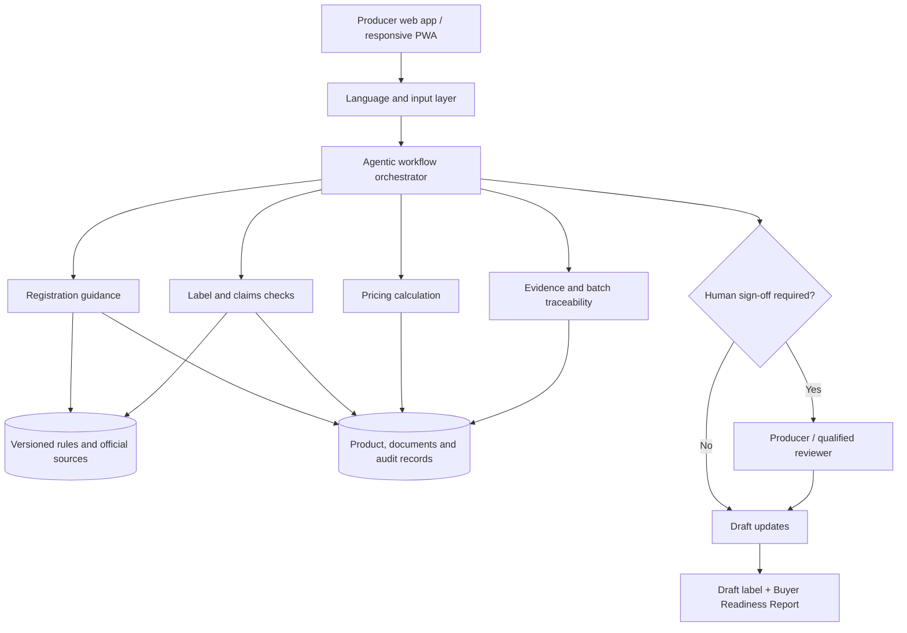

# Setuve AI

**From Local Kitchens to Larger Markets**

> **Status: Round 1 — Concept & Documentation Only**  
> **Problem Statement 6.3:** Micro food processors struggle to sell beyond their towns because the processes for registration, labels, traceable batches, shelf-life evidence and costing are difficult to manage.

**Setuve AI** (Kannada: *ಸೇತುವೆ*, “bridge”) is a **proposed** multilingual, human-supervised agentic AI platform for home-based and micro food processors. It aims to help producers organise business and product information, identify documentation gaps, prepare draft labels, compare channel economics, maintain traceable records and compile a **Buyer Readiness Report**.

**This repository is a Round 1 proposal, not a functioning application. No AI, speech, regulatory engine, live FSSAI integration or user testing has been implemented. Application development is intentionally deferred until selection for Round 2.**

## The problem

Small food businesses—particularly home-based makers of pickles, snacks, spices and millet products—often sell through local markets, fairs and WhatsApp. Larger retailers and online sales channels can involve requirements for suitable registration, appropriate packaged-food labels, documented product information and traceable batches. Producers also risk underpricing products when labour, packaging, delivery and channel fees are not calculated.

The challenge is **not a lack of good food products**; it is a lack of accessible, connected preparation and documentation support.

## Our proposed solution

Setuve AI offers a guided journey from a spoken or typed product description to a **reviewable buyer-readiness package**:

1. Choose **English**, **Kannada**, or **Kannada + English**; use voice where proven reliable, or text.
2. Describe a product; confirm extracted **ingredients, quantities and units**.
3. Receive **provisional FSSAI registration guidance** based on relevant business details, supported by official sources.
4. Prepare a **draft label** checked against a limited, dated and applicable rulebook.
5. Record **shelf-life and claims evidence** without fabricating test outcomes.
6. Compare **local and illustrative marketplace contribution** using editable costs.
7. Maintain **batch records, label versions, inventory and recorded orders**.
8. Produce a **Buyer Readiness Report** listing evidence, gaps, approvals and next actions.

The system is designed to coordinate tasks through explicit workflows and **human approval gates**, not to replace labs, authorities, food-safety experts or the producer.

## Eight proposed capabilities

| # | Capability | Proposed outcome |
|---|---|---|
| 1 | Multilingual AI assistant | English, Kannada and mixed-language voice/text intake with read-back confirmation |
| 2 | Registration guidance | Source-linked, provisional FSSAI pathway and missing-documents checklist |
| 3 | Food label studio | Versioned draft PDF and scoped deterministic checks |
| 4 | Shelf-life & claims evidence tracker | Unsupported claims and shelf-life values flagged for review |
| 5 | Pricing & channel comparison | Editable cost assumptions and estimated contribution per unit |
| 6 | Batch traceability & recall assistance | Batch-to-label and order linkage, internal incident preparation |
| 7 | Buyer Readiness Report | Consolidated evidence status, outstanding gaps and next actions |
| 8 | Agentic coordination & human sign-off | Stateful task orchestration with permissions, provenance and audit log |

All eight are **planned**, not implemented or validated.

## Conceptual architecture

**Proposed stack, subject to validation:** React + Vite PWA; Python FastAPI and Pydantic; PostgreSQL (SQLite acceptable for a demo); model-assisted extraction and explanation; deterministic regulatory and costing rules; versioned source references; server-side approval controls; PDF output. Speech vendor **not yet selected**. See [architecture](docs/04-architecture.md).

## Example producer journey

A Kannada-speaking mango pickle maker says:

> “ನಾನು 20 pickle jars ಮಾಡಿದ್ದೀನಿ, 2 kg ಮಾವಿನಕಾಯಿ ಮತ್ತು 200 grams chilli powder use ಮಾಡಿದ್ದೀನಿ.”

Setuve AI would *attempt* to extract 20 jars, 2 kg mango and 200 g chilli powder, then **ask for confirmation**. The producer could review registration guidance, create a draft label, identify missing shelf-life evidence, compare sales channels, assign a batch, and download the proposed readiness report. No spoken value is treated as confirmed without an appropriate check.

## Safety and scope boundaries

- **Not** an FSSAI certification, approval, legal determination or government filing service.
- **Not** a food-safety laboratory, shelf-life test or autonomous recall authority.
- Regulations must be checked for **product, package, sales channel, legal status and effective date**.
- User-supplied information is **not** called “officially verified” without actual verification.
- The proposed platform must not invent shelf life, registration status, nutrition values or health-claim evidence.
- Labels, final prices, externally shared reports and messages require **human authorization**.
- Urgent product-safety situations must be escalated promptly through appropriate official and expert channels; the app may prepare records but may not substitute for statutory duties.
- “Buyer ready” means **preparation status**, never guaranteed retail acceptance.

See [safety boundaries](docs/08-safety-and-trust.md).

## Round 1 scope & status

| Area | Status |
|---|---|
| Problem and proposed solution documentation | Described |
| High-level architecture | Proposed |
| User journey and MVP scope | Proposed |
| Official reference starting points | Collected (not a completed legal rulebook) |
| Competitor differentiation | Hypothesis, not verified uniqueness |
| Kannada voice benchmark | Not run |
| Ingredient/quantity/unit extraction testing | Not run |
| Label applicability/effective-date testing | Not run |
| Recipe-change dependency testing | Not run |
| Human sign-off/recall testing | Not run |
| Application code, working prototype or deployment | **Deferred to Round 2** |

### Planned Round 2 MVP

**One fictional/consenting mango-pickle producer; one SKU; one fixed label template; a small, reviewed set of relevant official rules; one illustrative online sales channel; example batches; and a Buyer Readiness Report.**

The team will only expand scope after end-to-end and safety tests pass. See [MVP roadmap](docs/06-mvp-and-roadmap.md) and [validation plan](docs/07-validation-plan.md).

## Documentation index

| Document | What it covers |
|---|---|
| [Problem statement](docs/01-problem-statement.md) | Challenges and beneficiaries |
| [Solution overview](docs/02-solution-overview.md) | Product purpose and user value |
| [Feature requirements](docs/03-feature-requirements.md) | Eight planned modules and acceptance approach |
| [Architecture](docs/04-architecture.md) | Components, workflows, data model and proposed stack |
| [User journey](docs/05-user-journey.md) | Mango pickle end-to-end demonstration |
| [MVP and roadmap](docs/06-mvp-and-roadmap.md) | Round 1 vs Round 2 boundaries and sequencing |
| [Validation plan](docs/07-validation-plan.md) | Six pending technology and safety tests |
| [Safety and trust](docs/08-safety-and-trust.md) | Human review, evidence, privacy and escalation |
| [References](docs/09-references.md) | Official research starting points |
| [Pitch deck plan](docs/10-presentation-outline.md) | 12-slide presentation structure |
| [Market differentiation](docs/11-landscape-and-positioning.md) | Honest positioning; research still open |
| [Publishing guide](PUBLISH_TO_GITHUB.md) | How to put this documentation on GitHub |

## Team and contact

**Team name, members, contact, organization and submission link:** To be added by the team before the submission. No personal details have been fabricated here.

## License and commercial use

A project license has **not yet been selected**. No reuse permission is implied by publication. See [license notice](LICENSE-NOTICE.md). The **Setuve AI** working name also requires trademark/name clearance before commercial launch.

---

*Documentation snapshot: 18 November 2026. Any regulatory statements are informational research starting points and must be independently checked before real-world use.*
